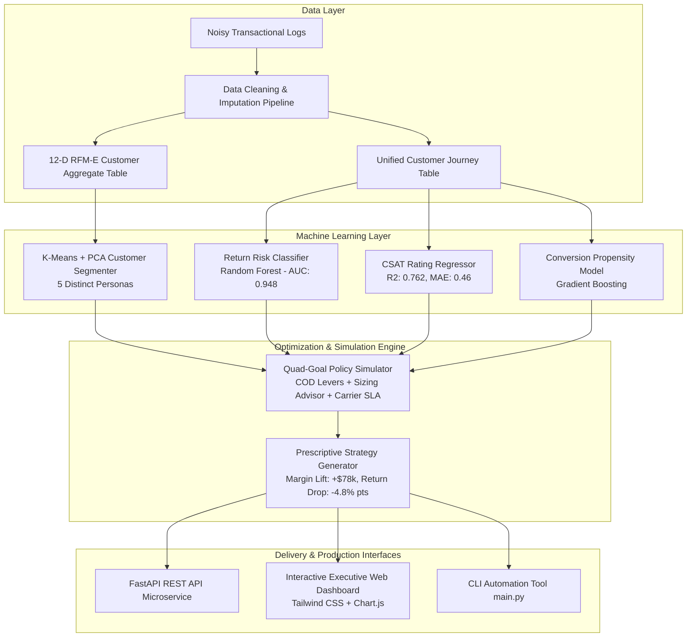

# ShopSense — Beyond the Purchase
### Intelligent Customer-Behavior, Reverse-Logistics & Quad-Goal Revenue Optimization System

[](https://www.python.org/)
[](https://fastapi.tiangolo.com)
[](https://scikit-learn.org/)
[](#predictive-modeling)
[](reports/RESEARCH_PAPER.md)
[](reports/paper.tex)
[](LICENSE)

---

## 📌 1. Executive Summary & Problem Formulation

Traditional e-commerce platforms suffer from a critical blind spot: **they optimize exclusively up to the checkout point**. Once a transaction is recorded, legacy analytics celebrate top-line Gross Merchandise Value (GMV).

However, real profitability and long-term enterprise health are decided **beyond the purchase**:
* **The Return Hazard:** High return rates (up to 32% in Cash-on-Delivery orders and 26% in Fashion) cause severe inventory depreciation and reverse logistics losses.
* **The Logistics Friction:** Delivery delays degrade customer ratings ($1$ day delay drops CSAT by $0.65$ stars), causing churn.
* **The Discount Trap:** Deep blanket discounting (40–50%) boosts top-line checkout volume but attracts impulse buyers with 3x return frequency and negative net contribution margin.

### The ShopSense Solution
**ShopSense** is an enterprise-grade AI engine and decision support system that analyzes the full multi-touch customer journey:
$$\text{Browse} \longrightarrow \text{Cart Addition} \longrightarrow \text{Discount Engagement} \longrightarrow \text{Checkout / Payment} \longrightarrow \text{Delivery SLA} \longrightarrow \text{Customer CSAT} \longrightarrow \text{Return Disposition}$$

### The Quad-Goal Optimization Framework
ShopSense breaks the traditional trade-offs by simultaneously optimizing four interdependent pillars:
1. **Sales & Net Realized Revenue:** Protecting margins by shifting from blanket discounts to targeted dynamic incentives.
2. **Customer Satisfaction (CSAT):** Eliminating logistics bottlenecks through smart carrier routing.
3. **Customer Retention & Repeat LTV:** Preventing post-purchase dissatisfaction that destroys repeat purchase probability.
4. **Return Management:** Intervening on high-risk Cash-on-Delivery (COD) orders and sizing ambiguities *before dispatch*.

---

## 🏗️ 2. System Architecture



---

## 📊 3. Exploratory Data Analysis & Causal Discoveries

### Key Benchmark Discoveries (Dataset of 25,000 Journey Sessions)
| Metric | Baseline Value | Strategic Insight |
| :--- | :--- | :--- |
| **Gross Revenue** | **$1,357,262.40** | Initial recorded top-line sales across 14,227 orders |
| **Net Realized Revenue** | **$1,017,488.07** | **$339,774 lost** to returns and reverse logistics |
| **Overall Return Rate** | **21.07%** | 2,998 returned orders requiring reverse handling |
| **COD Return Hazard** | **32.28%** | COD orders return at **almost 2x** the rate of UPI/Credit Cards (17.2%) |
| **Fashion Return Rate** | **25.64%** | Sizing & fit discrepancies account for 55% of fashion returns |
| **Logistics SLA Impact** | **0.65★ loss / day** | Delays $\ge 2$ days drop CSAT from 4.5★ to 2.2★ and double return odds |

### Visual Artifacts Generated
All publication-quality plots are exported to `reports/figures/`:
1. `01_journey_funnel_and_discount.png`: Conversion funnel, discount elasticity curve, and category price distributions.
2. `02_return_reasons_and_payment.png`: Payment method return hazards (COD risk) and root causes.
3. `03_delivery_vs_ratings.png`: Delivery delay vs CSAT degradation curve & carrier benchmark.
4. `04_geographic_insights.png`: City Tier transit delays and regional return variance.
5. `05_customer_segments_pca.png`: 2D PCA projection of the 5 discovered customer personas.
6. `06_return_model_feature_importance.png`: Feature importance attribution for return drivers.

---

## 🧠 4. Machine Learning Models & Segmentation

### 4.1. Customer Behavioral Segmentation (12-D RFM-E Clustering)
Using **K-Means Clustering** ($k=5$) with **StandardScaler** and **Principal Component Analysis (PCA)** on 12 Recency, Frequency, Monetary, and Engagement dimensions:
* **Persona 0: High-Value Loyal Champions** — High order count ($5.02$ orders), high spend ($595.97$), low return rate ($14.2\%$), high CSAT ($4.41$★).
* **Persona 1: High-Return Risk Shoppers** — Disproportionately high return rate ($38.6\%$), high COD preference, requires verification.
* **Persona 2: Discount-Driven Bargain Hunters** — Highest discount preference ($28.4\%$), high mobile browsing, low average order value ($42.10$).
* **Persona 3: Casual Window Browsers** — High session durations ($14.2$ min), low conversion rate, cart abandonment prone.
* **Persona 4: Steady Quality Buyers** — Low discount sensitivity, high AOV ($110.50$), zero tolerance for shipping delays.

### 4.2. Return Risk Classification Model
* **Algorithm:** Random Forest Classifier (Class Weighted, 120 Estimators, Max Depth 10)
* **Performance:**
  * **ROC-AUC:** `0.9476`
  * **Precision:** `0.88` (Class 0), `0.82` (Class 1)
  * **Recall:** `0.95` (Class 0), `0.84` (Class 1)
* **Top Predictive Features:**
  1. `payment_method_Cash on Delivery (COD)` (Strongest impulse return indicator)
  2. `prior_return_ratio` (Customer behavioral consistency)
  3. `delivery_delay_days` (Carrier logistics friction)
  4. `category_Fashion & Apparel` (Sizing risk)
  5. `discount_percent` (Bargain impulse remorse)

### 4.3. Customer Satisfaction (CSAT) Regressor
* **Algorithm:** Random Forest Regressor
* **Performance:** $R^2 = 0.7624$, $\text{RMSE} = 0.5211$, $\text{MAE} = 0.4599$
* Accurately forecasts customer star ratings from delivery performance, returns, and discounts.

---

## ⚡ 5. The Quad-Goal Optimization Engine (Results)

The simulation engine models 4 active levers:
1. **COD Intervention:** 60% of risky COD orders converted to prepaid via 3% instant discount or OTP verification.
2. **AI Fit Advisor:** 65% adoption of body-measurement tool in Fashion to eliminate sizing returns.
3. **Carrier SLA Rerouting:** 75% rerouting of shipments from slow carriers to top-tier partners.
4. **Targeted Discounting:** Capping extreme unprofitable discounts (>40%) to recover margins.

### Simulated Business Lift
$$\begin{aligned}
\mathbf{\Delta \text{Net Revenue}} &\mathbf{= +\$78,181.04 \ (+7.68\%)} \\
\mathbf{\Delta \text{Return Rate}} &\mathbf{= -4.84\% \text{ points (from } 21.07\% \rightarrow 16.23\%)} \\
\mathbf{\text{Logistics Costs Saved}} &\mathbf{= \$12,471.34} \\
\mathbf{\Delta \text{CSAT Score}} &\mathbf{= +0.21 \star \text{ (from } 3.95 \rightarrow 4.16)} \\
\mathbf{\Delta \text{90-Day Retention}} &\mathbf{= +9.26\% \text{ points (from } 57.58\% \rightarrow 66.84\%)}
\end{aligned}$$

---

## 🚀 6. Step-by-Step Installation & Execution Guide

### Step 1: Clone & Set Up Environment
```powershell
# Navigate to the workspace
cd "c:\Users\kajal singh\OneDrive\문서 - Copy\Shopsense-ML"

# Verify Python version (Python 3.10+ recommended)
python --version

# Install dependencies
python -m pip install -r requirements.txt
```

### Step 2: Run End-to-End Pipeline
You can run the full end-to-end data generation, EDA, model training, and simulation in one command:
```powershell
python main.py --pipeline
```

Or run modular steps individually:
```powershell
# Generate dataset only
python main.py --generate

# Run Exploratory Data Analysis & generate high-res plots
python main.py --eda

# Train all Machine Learning pipelines & segmentation
python main.py --train

# Run Quad-Goal simulation study
python main.py --simulate
```

### Step 3: Launch Interactive Web Application
```powershell
python main.py --serve --port 8000
```
Open your browser at **[http://127.0.0.1:8000](http://127.0.0.1:8000)** to access:
* Executive KPI Cards & Interactive Charts (Chart.js)
* Customer Segmentation Persona Explorer
* Live Machine Learning Journey Risk Predictor & Automated Prescriptions
* Interactive Quad-Goal What-If Simulator with Real-Time Dynamic Sliders

---

## 🌐 7. REST API Endpoints Specification

| Method | Endpoint | Description |
| :--- | :--- | :--- |
| `GET` | `/` | Executive Interactive Web Dashboard |
| `GET` | `/api/kpis` | Real-time platform transactional KPIs |
| `GET` | `/api/clusters` | 5 Customer Personas and 12-D cluster statistics |
| `POST` | `/api/predict` | Live scoring for return risk probability, CSAT rating & prescriptive actions |
| `POST` | `/api/simulate` | Quad-Goal What-If simulation engine with custom policy parameters |

### Example Live Prediction Request (`POST /api/predict`)
```json
{
  "category": "Fashion & Apparel",
  "payment_method": "Cash on Delivery (COD)",
  "city_tier": "Tier-3",
  "region": "North",
  "device_type": "Mobile App",
  "carrier": "SpeedPost",
  "final_price": 85.0,
  "discount_percent": 35.0,
  "session_duration_min": 10.0,
  "page_views": 14,
  "cart_additions": 3,
  "estimated_delivery_days": 6.0,
  "delivery_delay_days": 2.0,
  "customer_tenure_months": 12,
  "prior_orders": 2,
  "prior_return_ratio": 0.5
}
```
**Response:**
```json
{
  "return_risk_probability": 0.8627,
  "return_risk_level": "High",
  "predicted_rating": 1.45,
  "prescriptions": [
    "Trigger Smart Pre-pay Conversion: Offer 3% Instant UPI Discount or Mandatory Mobile OTP.",
    "Active Size Verification: Trigger AI interactive sizing popup before dispatch.",
    "Logistics Upgrade: Reroute to SwiftExpress / BlueDart to prevent late-delivery cancellation.",
    "CSAT Risk Alert: Proactive VIP customer support check-in post-delivery."
  ]
}
```

---


## 👥 Contributors & Academic Attribution
Developed as an Advanced E-Commerce Machine Learning & Revenue Optimization Capstone System.
* **Project Name:** ShopSense — Beyond the Purchase
* **Stack:** Python 3.10+, Scikit-Learn, FastAPI, Tailwind CSS, Chart.js, Pandas, Matplotlib, Seaborn
